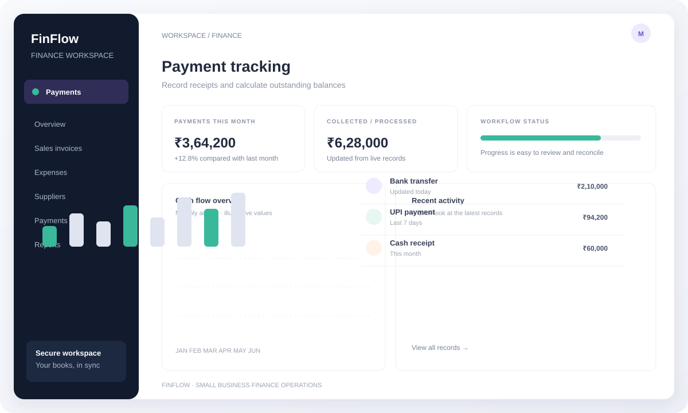

# FinTech Smart Invoice, Expense & Supplier Payment System

A finance operations platform for small businesses. **This is accounting software, not a marketplace.** Clients owe the business money against sales invoices; suppliers are parties the business pays for rent, utilities, materials and services.

## Stack
- Frontend: React 18, Vite, TypeScript, Recharts, Lucide
- Backend: Node.js, Express, TypeScript, Zod, JWT, bcrypt, pdf-lib, Nodemailer, node-cron
- Database: MongoDB Atlas + Mongoose
- Hosting target: Vercel (frontend), Render (API), MongoDB Atlas

## Run locally
1. Install Node.js 20+ and MongoDB. MongoDB must run as a replica set for payment transactions.
2. Copy `backend/.env.example` to `backend/.env`; configure MongoDB and a JWT access secret of at least 32 characters. Refresh sessions use random opaque tokens stored only as SHA-256 hashes in MongoDB.
3. Run `npm install` at repository root, then `npm run dev`.
4. API health: `http://localhost:4000/api/health`.
5. For a hosted API, set frontend `VITE_API_URL` to its origin (without a trailing slash).
6. To send invoice emails and enable reminders, configure `SMTP_HOST`, `SMTP_PORT`, `SMTP_SECURE`, `SMTP_USER`, `SMTP_PASS`, and `SMTP_FROM` in the backend environment. Never commit real SMTP credentials. The daily overdue reminder runs at `REMINDER_CRON` (default 09:00) in `REMINDER_TIMEZONE` (default `Asia/Kolkata`).

## Frontend integration
Includes login/register, role-aware navigation, live dashboard aggregates, searchable finance lists, client/supplier/expense/invoice/supplier-bill forms, expense approvals, and customer/supplier payment actions. Registration creates an Employee account; elevated roles must be granted by an administrator. The app uses the existing API endpoints and requires a running backend.

## API
- POST /api/auth/register and /api/auth/login (refresh token set as an HttpOnly cookie); POST /api/auth/refresh rotates the cookie-backed session; POST /api/auth/logout revokes the current session; POST /api/auth/logout-all revokes all sessions for that account
- GET/POST /api/clients and GET/POST /api/suppliers
- POST /api/suppliers/:id/portal-account (Admin only; creates a linked supplier login)
- GET/POST /api/invoices; POST /api/invoices/:id/payments
- GET /api/invoices/:id/pdf (authenticated PDF download)
- POST /api/invoices/:id/email (emails the PDF to the client email on file)
- GET/POST /api/expenses; PATCH /api/expenses/:id/review
- GET /api/dashboard; GET /api/audit-logs
- GET/POST /api/supplier-bills; POST /api/supplier-bills/:id/payments

## Financial integrity
Money is stored as integer paise. Invoice tax and discount are calculated server-side (discount before tax). Payment, balance update and audit entry use MongoDB transactions. Overpayments are rejected. Public registration cannot assign privileged roles.

## Limitations / production work
Safe edit/delete for clients, suppliers and pending expenses; unpaid invoices and supplier bills can be edited/deleted, while paid records and reviewed expenses are protected; complete automated API tests and production deployment remain unfinished. Access tokens are held in frontend memory; refresh tokens are opaque, rotated on use, stored as hashes server-side, and transported in HttpOnly cookies. In production, configure HTTPS and set `CLIENT_URL` to the exact frontend origin; the API uses `SameSite=None; Secure` cookies and validates the request Origin. SMTP must be configured before email delivery or scheduled reminders can run. This security improvement is not a substitute for a security review. This is not certified accounting or tax software.

## Roadmap
- [x] Core API, authentication, finance models and transactional payment endpoints
- [x] Live frontend auth, dashboard, searchable lists, create forms and payment/approval actions
- [x] Live frontend integration (PR #1)
- [x] Admin-provisioned supplier portal login with supplier-scoped bill listing
- [x] Safe edit/delete for clients, suppliers, pending expenses, and unpaid invoices/supplier bills
- [x] PDF invoice generation and authenticated download
- [x] Email invoices to the client contact using configured SMTP
- [x] Daily scheduled overdue reminders with per-invoice/per-day deduplication
- [x] Rotating, revocable refresh sessions and HttpOnly cookie storage (current-session and all-session logout)
- [x] Automated backend unit tests for finance calculations and refresh-session security helpers
- [x] CI runs backend tests before production builds
- [ ] Deployment configuration and production rollout

## Product visuals

The following original illustrations show the main FinFlow screens and workflows. They are product concept visuals for documentation, not screenshots of a deployed production instance.

<table>
<tr>
<td width="50%">
<strong>1. Finance dashboard</strong> Income, expenses and receivables at a glance.
</td>
<td width="50%">
<strong>2. Sales invoices</strong> Customer billing and invoice status tracking.
</td>
</tr>
<tr>
<td>
<strong>3. Invoice details</strong> Line items, tax, discounts and balance due.
</td>
<td>
<strong>4. Expense approvals</strong> Employee submissions and finance review.
</td>
</tr>
<tr>
<td>
<strong>5. Supplier payables</strong> Bills owed to service providers and vendors.
</td>
<td>
<strong>6. Client directory</strong> Customer records linked to sales invoices.
</td>
</tr>
<tr>
<td>
<strong>7. Supplier portal</strong> Supplier-scoped bill and payment visibility.
</td>
<td>
<strong>8. Payment tracking</strong> Receipts, payment methods and outstanding balances.
</td>
</tr>
<tr>
<td>
<strong>9. Audit activity</strong> Traceable records of important finance actions.
</td>
<td>
<strong>10. Secure sessions</strong> Role checks, origin validation and refresh-token rotation.
</td>
</tr>
</table>
