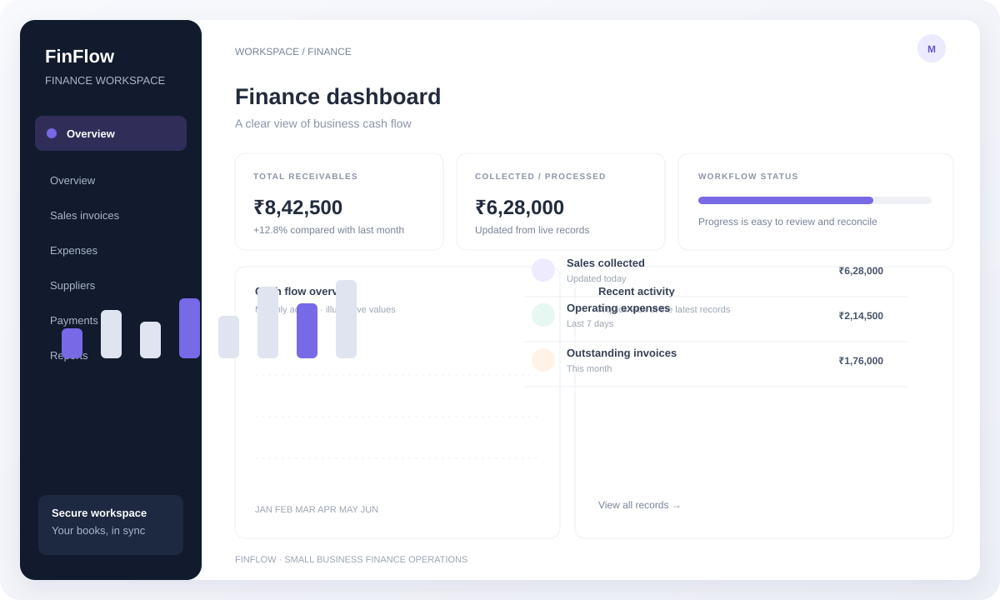
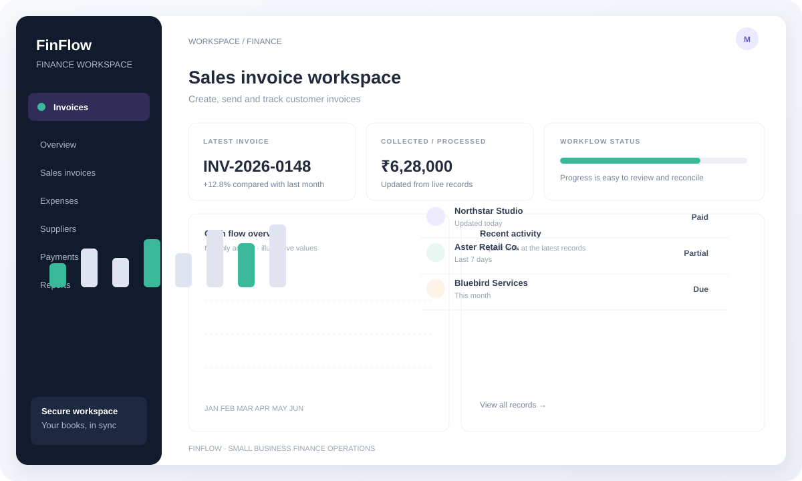
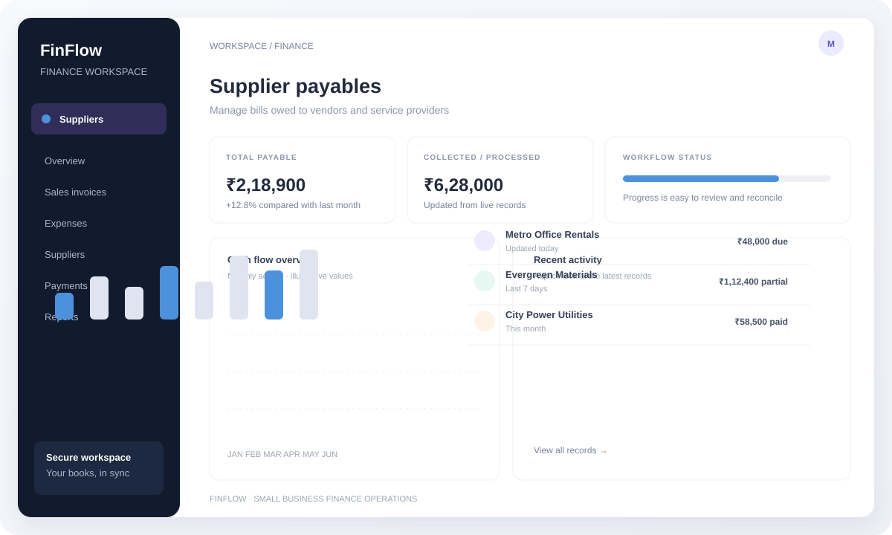
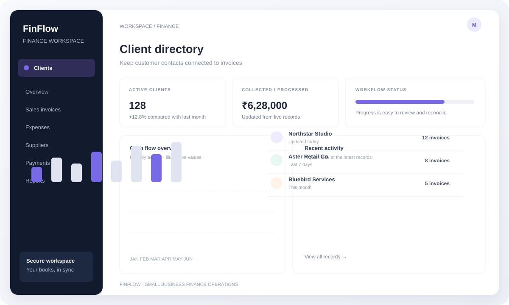
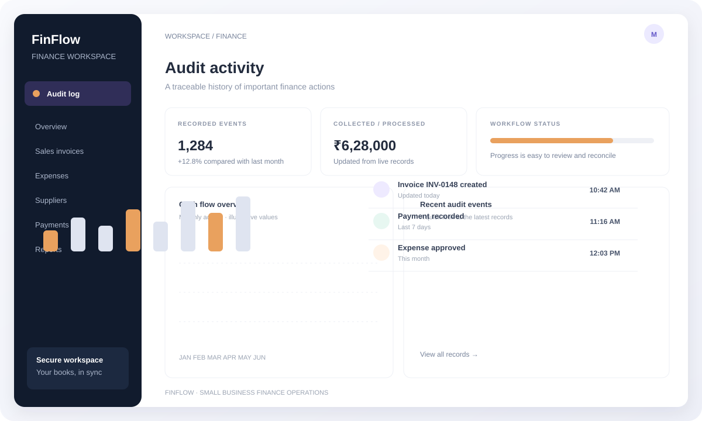

<div align="center">

# FinFlow
### Smart Invoice, Expense & Supplier Payment System

**A role-based finance operations workspace for small businesses — from customer invoicing and expense approvals to supplier bills, payment tracking and audit history.**


[**Open live frontend**](https://fin-tech-smart-invoice-expense-supp.vercel.app) · [**Deployment guide**](docs/deployment.md) · [**CI workflow**](.github/workflows/ci.yml)

</div>

---

## Product overview

FinFlow is a small-business finance operations application, not a marketplace or payment processor. It separates two important money flows:

- **Accounts receivable:** clients owe the business money for sales invoices.
- **Accounts payable:** the business owes suppliers for expenses, materials, rent, utilities and services.

The application brings those workflows together with employee expense submissions, finance-team review, supplier-scoped portal access, PDF invoices, email delivery, overdue reminders and an audit trail.

The frontend is a React single-page application; the API is an Express service backed by MongoDB. The repository includes a Render Blueprint for a separately hosted API and static frontend. A public frontend URL is available, but a configured production rollout and live staging verification are still outstanding. Use synthetic data only.

## Workspaces and roles

| Role | What the application supports |
|---|---|
| **Admin** | Finance dashboard, clients, suppliers, invoices, expenses, supplier bills, payment actions, audit history and supplier portal provisioning |
| **Accountant** | Finance dashboard and day-to-day finance records, review and payment workflows |
| **Employee** | Submit and track personal expenses |
| **Supplier** | Sign in to a linked supplier portal and view that supplier's bills |

Public registration creates an Employee account only. Elevated roles are assigned administratively; supplier portal accounts are provisioned by an Admin and linked to a supplier record.

## Implemented workflows

### Sales invoices and receivables
- Create and maintain client records.
- Create sales invoices with line items, tax and discount.
- Calculate invoice totals on the server.
- Record partial or full customer payments and update the outstanding balance.
- Download authenticated invoice PDFs.
- Email invoice PDFs to the client's email address when SMTP is configured.
- Review invoice status and receivables in the finance dashboard.

### Expenses and approvals
- Employees submit expenses for review.
- Admins and Accountants can review pending submissions.
- Employees can view their own expense records; finance roles can review the broader expense workflow.
- Pending expenses can be edited or deleted; reviewed expenses are protected from those changes.

### Supplier payables
- Create and maintain supplier records.
- Create supplier bills and record partial or full supplier payments.
- Track bill totals, paid amounts, outstanding balances and payment status.
- Admins can create a supplier portal account linked to a supplier.
- Supplier accounts are restricted to bills associated with their linked supplier record.
- Supplier records with existing bills or linked portal accounts are protected from deletion.

### Finance visibility and audit
- Dashboard aggregates include invoiced totals, receivables, current-month expenses and received payments.
- Search finance lists in the frontend.
- Review audit events for important finance actions.
- Edit or delete eligible unpaid invoices and supplier bills; paid records are protected.

### Email and scheduled reminders
- Send invoice PDFs to the client contact on file.
- Run a daily overdue-invoice reminder job using `node-cron`.
- Deduplicate reminders per invoice and calendar day using a unique reminder-log index.
- Configure the reminder time and timezone using `REMINDER_CRON` and `REMINDER_TIMEZONE`.

Email delivery requires working SMTP credentials. The reminder task runs inside the API process; it is not a durable external scheduler.

## Financial integrity

Money is stored as **integer paise**, not floating-point rupees. The backend finance helpers:
- Convert rupees to paise with safe-integer validation.
- Calculate invoice line totals, subtotal, discount, tax and total on the server.
- Apply discounts before tax.
- Reject negative, non-finite, fractional-invalid or unsafe monetary values.
- Use safe integer arithmetic for supplier bill totals.

Customer and supplier payment workflows use MongoDB transactions to update the payment record, corresponding invoice/bill balance and audit entry together. Overpayments and amounts below INR 0.01 are rejected. MongoDB must run as a replica set or compatible transaction-capable deployment.

> FinFlow records payments made outside the application. It does not integrate a card/UPI payment gateway, initiate bank transfers, or settle funds.

## Technology stack

| Layer | Technologies |
|---|---|
| Frontend | React 18, TypeScript, Vite 6 |
| UI and charts | Lucide React, Recharts, custom responsive CSS |
| Backend | Node.js 20+, Express 4, TypeScript |
| Validation | Zod |
| Database | MongoDB Atlas, Mongoose 8 |
| Authentication | JWT access tokens, bcryptjs password hashing, opaque rotating refresh sessions |
| Documents | pdf-lib for invoice PDF generation |
| Email | Nodemailer with configurable SMTP |
| Scheduling | node-cron |
| Security | Helmet, CORS origin allowlist, API rate limiting, trusted-origin validation |
| Hosting configuration | Render Blueprint; public frontend demo hosted on Vercel |
| Tests and CI | Node.js built-in test runner, TypeScript, GitHub Actions |

## Architecture

```text
Browser
  |
  +-- React + Vite frontend
  |     +-- Role-aware finance workspace
  |     +-- In-memory access token
  |     +-- HttpOnly refresh cookie
  |
  +-- HTTPS / JSON API
        |
        v
      Express + TypeScript API
        +-- Authentication and role checks
        +-- Client and supplier records
        +-- Invoice and customer payment workflows
        +-- Expense submission and review
        +-- Supplier bills and supplier payments
        +-- PDF invoice generation and SMTP delivery
        +-- Scheduled overdue reminder task
        +-- Audit history and dashboard aggregates
        |
        v
      MongoDB
        +-- Users and refresh sessions
        +-- Clients and suppliers
        +-- Invoices and customer payments
        +-- Expenses
        +-- Supplier bills and supplier payments
        +-- Audit logs and reminder deduplication
```

The codebase is an npm workspaces monorepo with separate `backend` and `frontend` packages. The API validates runtime environment variables at startup, and its health endpoint reports both service and database readiness.

## Repository layout

```text
.
├── backend/
│   ├── src/
│   │   ├── server.ts          # Express API, routes and models
│   │   ├── finance.ts         # Integer-paise calculations
│   │   ├── security.ts        # Refresh-session and cookie helpers
│   │   └── access.ts          # Expense access and review policies
│   ├── test/                  # Finance, access and security unit tests
│   ├── .env.example
│   └── package.json
├── frontend/
│   ├── src/
│   │   ├── App.tsx            # Role-aware finance UI
│   │   ├── api.ts             # API client and session handling
│   │   └── styles.css
│   └── package.json
├── docs/
│   └── deployment.md
├── .github/workflows/
│   └── ci.yml
├── render.yaml                # Render Blueprint
└── package.json               # npm workspaces and root scripts
```

## Run locally

### Prerequisites

- Node.js 20 or newer and npm.
- MongoDB running as a replica set (required for transactional payment operations).
- SMTP credentials only if you want to test invoice email or overdue reminders.

### 1. Clone and install

```bash
git clone https://github.com/matiur25580/FinTech-Smart-Invoice-Expense-Supplier-Payment-System.git
cd FinTech-Smart-Invoice-Expense-Supplier-Payment-System

npm install
```

The repository currently has no root `package-lock.json`; use `npm install` rather than `npm ci`. The GitHub Actions workflow also uses `npm install` for this reason.

### 2. Configure the backend

```bash
cp backend/.env.example backend/.env
```

Set the required values in `backend/.env`:

```dotenv
NODE_ENV=development
PORT=4000
MONGODB_URI=mongodb://127.0.0.1:27017/fintech_smart_invoice
JWT_ACCESS_SECRET=replace-with-a-unique-random-secret-at-least-32-characters
CLIENT_URL=http://localhost:5173

# Optional: required for invoice email and overdue reminders
SMTP_HOST=
SMTP_PORT=587
SMTP_SECURE=false
SMTP_USER=
SMTP_PASS=
SMTP_FROM=FinFlow <no-reply@example.com>

# Daily reminder schedule
REMINDER_CRON=0 9 * * *
REMINDER_TIMEZONE=Asia/Kolkata
```

The backend validates its environment at startup. `MONGODB_URI` and a `JWT_ACCESS_SECRET` of at least 32 characters are required. The frontend API client defaults to `http://localhost:4000`; set `VITE_API_URL` only when your API runs at a different origin.

Never commit real database, JWT or SMTP credentials.

### 3. Start both workspaces

From the repository root:

```bash
npm run dev
```

This starts the backend and Vite frontend concurrently.

- Frontend: [http://localhost:5173](http://localhost:5173)
- API health: [http://localhost:4000/api/health](http://localhost:4000/api/health)

The health endpoint returns HTTP 200 when MongoDB is connected and HTTP 503 when the database is unavailable.

### Useful root scripts

| Command | Purpose |
|---|---|
| `npm run dev` | Start backend and frontend together |
| `npm run dev:backend` | Start API in watch mode |
| `npm run dev:frontend` | Start Vite development server |
| `npm run build` | Compile backend and build frontend |
| `npm run test` | Run backend unit tests |

## Environment reference

| Variable | Required | Purpose |
|---|---|---|
| `MONGODB_URI` | Yes | MongoDB connection string; use a replica set for transactions |
| `JWT_ACCESS_SECRET` | Yes | Unique signing secret, minimum 32 characters |
| `NODE_ENV` | No | Runtime mode; set to `production` when deployed |
| `PORT` | No | API port; defaults to 4000 |
| `CLIENT_URL` | No | Exact allowed frontend origin; defaults to local Vite origin |
| `SMTP_HOST` | Email only | SMTP server hostname |
| `SMTP_PORT` | Email only | SMTP port; defaults to 587 |
| `SMTP_SECURE` | Email only | Whether SMTP uses a secure connection |
| `SMTP_USER`, `SMTP_PASS` | Email only | SMTP authentication credentials |
| `SMTP_FROM` | Email only | Sender name/address |
| `REMINDER_CRON` | No | Cron expression; defaults to 09:00 daily |
| `REMINDER_TIMEZONE` | No | Cron timezone; defaults to `Asia/Kolkata` |
| `VITE_API_URL` | No | Frontend API origin; defaults to `http://localhost:4000` |

## API overview

All endpoints are under `/api`. Protected routes require an access token in the `Authorization: Bearer <token>` header. Refresh and logout endpoints use the HttpOnly refresh cookie and trusted-origin checks.

| Area | Routes | Purpose |
|---|---|---|
| Health | `GET /health` | API and database readiness |
| Authentication | `POST /auth/register`, `POST /auth/login` | Employee registration and sign-in |
| Sessions | `POST /auth/refresh`, `POST /auth/logout`, `POST /auth/logout-all` | Rotate refresh token or revoke sessions |
| Clients | `GET/POST /clients`, `PATCH/DELETE /clients/:id` | Customer records |
| Suppliers | `GET/POST /suppliers`, `PATCH/DELETE /suppliers/:id` | Supplier records |
| Supplier portal | `POST /suppliers/:id/portal-account` | Admin provisions a linked supplier login |
| Invoices | `GET/POST /invoices`, `PATCH/DELETE /invoices/:id` | Sales invoices |
| Customer payments | `POST /invoices/:id/payments` | Record a payment against an invoice |
| Invoice documents | `GET /invoices/:id/pdf`, `POST /invoices/:id/email` | Authenticated PDF and email delivery |
| Expenses | `GET/POST /expenses`, `PATCH /expenses/:id`, `DELETE /expenses/:id` | Expense submissions and maintenance |
| Expense review | `PATCH /expenses/:id/review` | Approve or reject a pending expense |
| Supplier bills | `GET/POST /supplier-bills`, `PATCH/DELETE /supplier-bills/:id` | Supplier payable records |
| Supplier payments | `POST /supplier-bills/:id/payments` | Record a payment against a supplier bill |
| Dashboard | `GET /dashboard` | Finance aggregates |
| Audit | `GET /audit-logs` | Finance activity history |

Role authorization is enforced by the API, not just by hiding frontend navigation. Supplier bill listing is scoped to the supplier linked to the authenticated portal account. Supplier portal users cannot create or view employee expenses.

## Authentication and security

- Passwords are hashed with bcryptjs.
- Access tokens are short-lived JWTs held in frontend memory.
- Refresh tokens are high-entropy opaque values; only SHA-256 hashes are stored in MongoDB.
- Refresh tokens rotate on use and can be revoked for the current session or all sessions for an account.
- Refresh cookies are HttpOnly and scoped to `/api/auth`; production cookies use `Secure; SameSite=None`.
- Refresh and logout requests validate the configured frontend Origin.
- API requests use Helmet security headers, an explicit CORS origin and a rate limit of 300 requests per 15 minutes.
- Expense and supplier portal routes enforce role and ownership boundaries.
- Payment, balance and audit writes are grouped in MongoDB transactions.

Use HTTPS in production, set `CLIENT_URL` to the exact deployed frontend origin, restrict Atlas network access, and store secrets in the hosting provider's secret manager. These controls are not a substitute for a security review or a production penetration test.

## Tests and CI

Run backend unit tests:

```bash
npm run test
```

The current Node test-runner suite covers:

- Integer-paise conversion, safe arithmetic and invoice calculations.
- Discount-before-tax behavior and invalid invoice input.
- Expense listing permissions, role-specific submission status and review policy.
- Refresh-token generation and hashing.
- HttpOnly cookie attributes, cookie parsing and logout cookie clearing.
- Exact trusted-origin validation.

GitHub Actions runs on pull requests and pushes to `main`. It installs workspace dependencies with `npm install`, runs backend tests, then builds both backend and frontend workspaces.

The repository does not currently include API integration tests or automated browser end-to-end tests. CI success therefore verifies the checked-in unit tests and production builds, not live MongoDB transaction behavior, SMTP delivery, staging configuration or production readiness.

## Deployment

A Render Blueprint is included in [`render.yaml`](render.yaml), defining:
- **finflow-api:** Node.js/Express API, with `/api/health` health checks.
- **finflow-web:** React/Vite static site published from `frontend/dist`.
- **MongoDB:** hosted separately on MongoDB Atlas; the Blueprint does not provision or migrate the database.

Follow the detailed [Render deployment guide](docs/deployment.md) for Atlas setup, environment variables, service URLs, staging checks and rollout caveats.

The repository also links to a public frontend demo:

- [FinFlow frontend demo](https://fin-tech-smart-invoice-expense-supp.vercel.app)

That Vercel URL is a frontend deployment link, not evidence that the API, database, SMTP or all finance workflows are currently configured and operational. The README's production-readiness checklist remains open for live staging rollout, Atlas-backed API smoke tests and review.

### Reminder scheduling caveat

The overdue reminder cron job runs inside the API process. If a free hosting instance sleeps or restarts, the job may not execute at the intended time. For dependable production reminders, use an always-on API instance or move the schedule to a dedicated managed cron job/worker.

## Product visuals

The following are original product concept illustrations for documentation, not screenshots of a verified production deployment.

<div align="center">

### 01 · Finance dashboard



*Income, expenses and receivables at a glance.*

---

### 02 · Sales invoices



*Customer billing, invoice creation and payment status tracking.*

---

### 03 · Invoice details


*Line items, tax, discounts and outstanding balances.*

---

### 04 · Expense approvals


*Employee submissions, review decisions and expense control.*

---

### 05 · Supplier payables



*Bills owed to service providers and vendors.*

---

### 06 · Client directory



*Customer records connected to the sales invoice workflow.*

---

### 07 · Supplier portal


*Supplier-scoped access to bills and payment information.*

---

### 08 · Payment tracking


*Payment receipts, methods and remaining balances.*

---

### 09 · Audit activity



*A traceable timeline of important finance actions.*

---

### 10 · Secure sessions


*Role checks, trusted-origin validation and rotating refresh sessions.*

</div>

## Roadmap

- [x] Core API, authentication, finance models and transactional payment endpoints
- [x] Role-aware frontend with dashboard, finance lists, create forms and payment/review actions
- [x] Supplier portal provisioning and supplier-scoped bill access
- [x] Safe edit/delete for eligible clients, suppliers, pending expenses and unpaid finance records
- [x] PDF invoice generation and authenticated download
- [x] SMTP invoice delivery and deduplicated overdue reminders
- [x] Rotating, revocable refresh sessions and HttpOnly cookie storage
- [x] Backend finance and security helper unit tests
- [x] GitHub Actions test and build workflow
- [x] Render Blueprint and deployment documentation
- [ ] Live staging rollout and Atlas-backed API smoke tests
- [ ] API integration and browser end-to-end test coverage
- [ ] Production review of reminder scheduling, backups, monitoring and security

## Author

**Matiur Rahaman** · Full-Stack Developer

- GitHub: [@matiur25580](https://github.com/matiur25580)
- Portfolio: [developer-portfolio-client.vercel.app](https://developer-portfolio-client.vercel.app)

